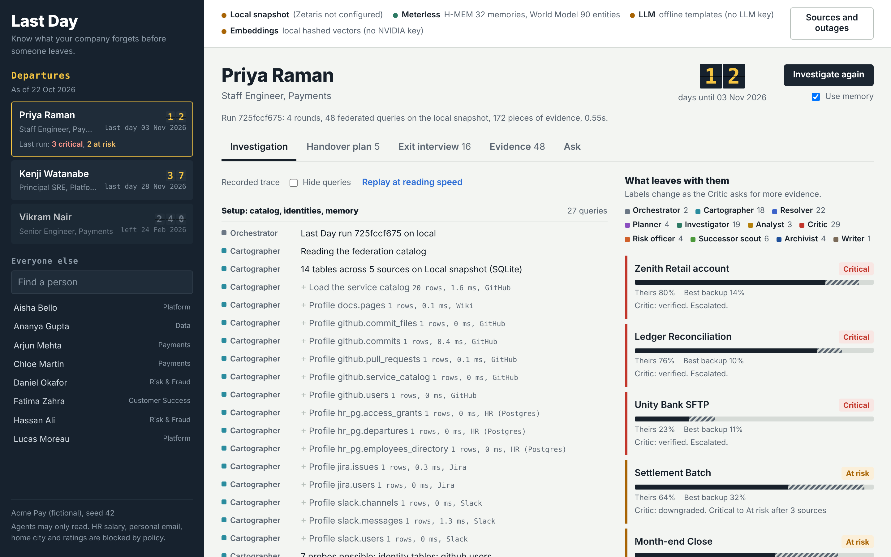
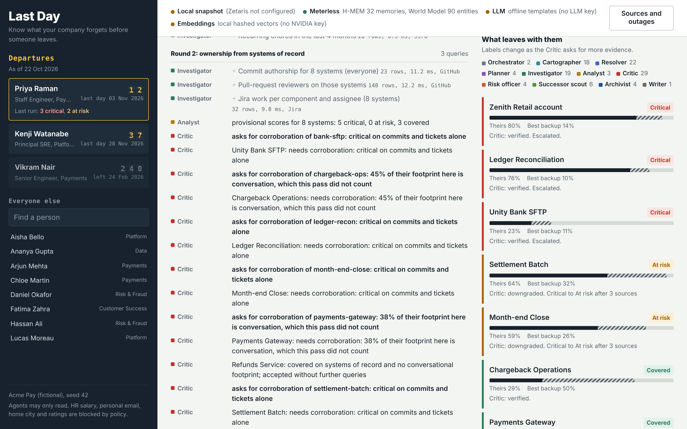
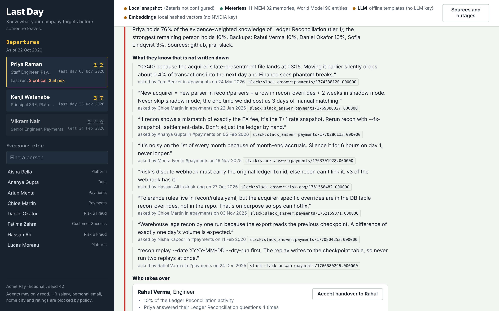
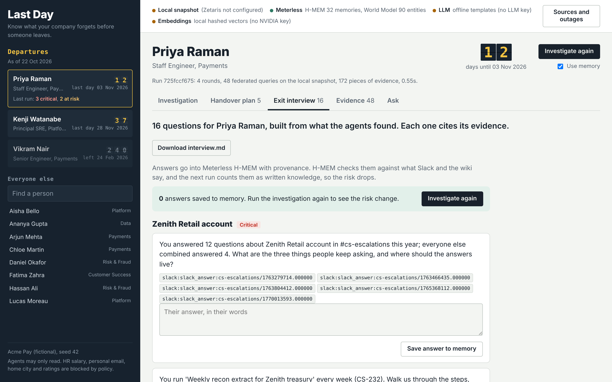
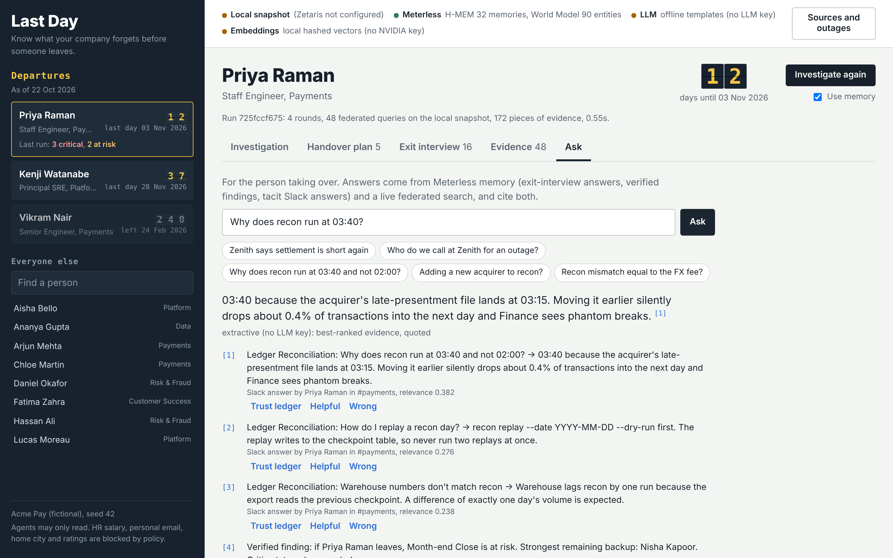
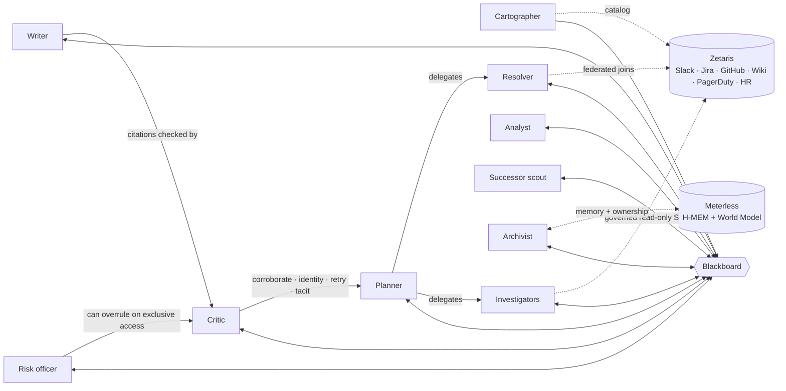

# Last Day

**Know what your company forgets before someone leaves.**

When someone hands in their notice, their manager has a few weeks to work out what only that person
knows. The answer is scattered across Slack threads, Jira tickets, commits, a stale wiki and HR, and
nobody has time to read it all. Last Day does that investigation with a team of agents. They query every
system in place through **Zetaris**, argue about what they find until the evidence holds, and produce two
things a manager can act on this week: a **handover plan** and an **exit interview**, where every claim
links to the query that found it. The answers go into **Meterless** memory, so the next run counts them as
written down and the risk visibly drops.



Built for the **Open Agent Hackathon 2026**, Track 1: *Solving Fragmented Intelligence*.

---

## Run it (2 minutes, no keys needed)

You need Python 3.10+ and Node.js 22.7+ (for the Meterless engines).

```bash
make setup        # venv, requirements, demo companies
make serve        # http://localhost:8000
```

Click **Priya Raman** on the departures board, then **Investigate**. Or in the terminal:

```bash
.venv/bin/python -m lastday run Priya          # add --sql to print every federated query
.venv/bin/python -m lastday ask "Why does recon run at 03:40?"
make test                                      # 43 tests, ~10 s
```

Without Zetaris credentials the agents query a local snapshot that uses **the same qualified table names**
as the Zetaris registration (`slack.messages`, `hr_pg.employees_directory`, ...). Without an NVIDIA key the
wording falls back to templates. The reasoning (queries, scores, critique, escalation) never depends on the
LLM. To run on Zetaris, see [Zetaris setup](docs/ZETARIS_SETUP.md): it is two commands once your instance is up.

`python -m lastday doctor` says what is configured and what is missing.

## What happens when you press Investigate

The demo company is **Acme Pay**, a fictional payments startup with 18 people and six systems that disagree
about who everyone is. Priya Raman, a staff engineer, leaves in 12 days.

1. **The Cartographer** reads the Zetaris catalog and works out what each table can tell it (person columns,
   timestamps, links to services). Nothing is hardcoded per source: register PagerDuty halfway through the
   demo and the next run discovers it.
2. **The Resolver** links Slack, Jira, GitHub and PagerDuty accounts to HR employees with federated joins.
   Two people show up as "Rahul V"; it leaves that account unassigned until someone asks.
3. **Round 1.** Investigators find everywhere Priya shows up. The Planner keeps 8 systems and drops the noise.
4. **Round 2.** Ownership from systems of record (commits, reviews, tickets). The Analyst scores each area:
   5 look critical.
5. **The Critic refuses.** Commits and tickets over-credit whoever types the code. It asks for corroboration
   from conversation, incidents and docs, for the ambiguous "Rahul V" account to be resolved, and for the actual
   tacit knowledge behind every critical label. The Planner hands each request to another agent.
6. **Round 3.** The extra evidence shows Rahul Verma answers Settlement Batch questions too. The Critic
   downgrades it from critical to at risk and writes down why. Unity Bank SFTP stays critical although Priya
   barely touches it: she holds the only SFTP key, so the Risk officer escalates it for this week.
7. **The Archivist** stores the tacit answers in Meterless H-MEM and catches a contradiction: the wiki says
   "silence the recon alert for 24 hours", Priya told the team "6 hours, never longer". The World Model's
   source priority keeps her value.
8. **The Writer** produces the handover plan and 16 exit-interview questions. The Critic checks every citation
   before anyone sees it.

That's 4 rounds, about 48 federated queries and 2 seconds on the snapshot. Every step is in the trace.

| | |
|---|---|
|  |  |
|  |  |

## The agents

They never call each other. They post findings and requests on a shared **blackboard**, and the
orchestrator runs rounds until the Critic has nothing left to ask (at most 6).



| Agent | Does | Pushes back on |
|---|---|---|
| Cartographer | Discovers tables and column roles in the Zetaris catalog; decides which probes are possible | |
| Resolver | One person, many accounts: email joins, name matching, co-activity disambiguation | |
| Planner | Plans round 1, then turns every open request into delegated work | Drops requests no source can serve, with a reason |
| Investigators | Footprint, code, reviews, work, conversation, docs, access, chores, and any discovered activity table | |
| Analyst | Evidence-weighted share of each area for the leaver and the best remaining backup | |
| Critic | Six written rules; accepts, downgrades or upgrades labels; checks every citation | Labels built on commits alone, unresolved identities, failed sources, critical areas with no captured knowledge |
| Risk officer | Business priority: tier, days left, chores that stop, keys nobody else holds; escalates | The Critic, if a knowledge-based "covered" label hides access nobody else holds (a key cannot be shared like knowledge) |
| Successor scout | Who should take each area, with numbered reasons a manager can disagree with | |
| Archivist | Meterless H-MEM and World Model: memory, provenance, conflicts, ownership history | Stale wiki pages that contradict the expert |
| Writer | Handover plan and exit interview; LLM wording optional | |

What makes it more than a pipeline: requests flow back to the Planner, labels change between rounds with
reasons, failed sources are retried and then worked around at lower confidence, the Writer's output is
checked by the Critic before anyone sees it, and the memory written in one run changes the next. [Architecture](docs/ARCHITECTURE.md) has the rules,
thresholds and formulas.

## Sponsor technology

| | How Last Day uses it |
|---|---|
| **Zetaris** | The data harness. Each SaaS API is a Lightning REST table flattened by a SchemaStore view; HR is a governed Postgres datasource where only a view without compensation or personal data is registered. Agents send read-only Lightning SQL with cross-source joins (HR × Slack × Jira) and discover sources from the catalog. Registration SQL is generated from one manifest. |
| **Meterless** | The memory. The unmodified H-MEM and World Model reference engines (Apache-2.0) run in a small Node bridge. H-MEM holds tacit answers and exit-interview answers with provenance, trust-ledger history and conflict detection. The World Model holds people, accounts, systems and bitemporal `owned_by` edges: accepting a handover closes the old edge instead of deleting it. |
| **NVIDIA** | NIM on build.nvidia.com: retrieval embeddings (`llama-3.2-nv-embedqa-1b-v2`) attribute Slack threads to systems and rank evidence for successor questions; a NIM chat model writes the handover summaries and answers. |
| **Cursor** | The development environment. `AGENTS.md` and `.cursor/rules/` hold the rules that keep the system honest (blackboard only, governed SQL, cited claims), so Cursor's agent follows them when editing. |

Details and what is unique about each: [Sponsor technology](docs/SPONSOR_TECH.md).

## Does it work? Evaluation on 7 generated companies

The generator plants what is really at risk for every departing person, including **decoys** (areas where a
commit-only view says critical but others answer the questions) and keys only one person holds. The agents
never read the ground truth; `python -m lastday eval` does, after each run.

| Seeds | Areas scored | Label accuracy | Handover precision | Handover recall | Decoys caught |
|---|---|---|---|---|---|
| 42, 7, 13, 21, 5, 77, 99 | 57 | **96.5%** | 97.1% | **100%** | **5 / 5** |

Reproduce with `make eval` (writes `samples/eval.json`). The two misses are borderline shares
(at risk vs critical at 0.49 vs 0.63). The ground truth comes from the same generator, so this measures the
agents' reasoning, not real-world accuracy.

[`samples/`](samples/) has full outputs (handover, interview, the whole blackboard and the event trace) for
five runs across three companies, including one with Jira down.

## Configuration

Copy `.env.example` to `.env`. Everything is optional.

| Variable | For |
|---|---|
| `ZETARIS_REST_URL`, `ZETARIS_ORG_ID`, `ZETARIS_API_KEY` | Query through Zetaris (switches automatically when set) |
| `SAAS_PUBLIC_URL`, `SAAS_TOKEN`, `HR_JDBC_URL`, `HR_PG_*` | How Zetaris reaches Acme Pay's systems |
| `NVIDIA_API_KEY` | NIM chat model and embeddings |
| `LLM_BASE_URL`, `LLM_MODEL`, `LLM_API_KEY` | Any OpenAI-compatible model instead |
| `LASTDAY_SEED` | Which generated company |

## Project layout

```
lastday/
  agents/        blackboard, orchestrator and the ten agents
  federation/    Zetaris client, local snapshot, manifest, governance, registration SQL
  meterless/     client for the Meterless bridge
  llm/           NIM chat + embeddings, with offline fallbacks
  data/          the company generator and its storylines
  saas/          Slack/Jira/GitHub/wiki/PagerDuty APIs that Zetaris registers as REST tables
  server.py      web API (Starlette) with server-sent events for the live trace
  eval.py        scoring against planted ground truth
meterless-bridge/  Node bridge serving the vendored Meterless engines
web/             the UI (vanilla JS, no build step)
zetaris/sql/     registration SQL templates, generated from the manifest
tests/           43 tests, standard library only
samples/         example outputs and traces
docs/            architecture, Zetaris setup, sponsor tech, demo script, submission kit
```

## Pre-existing components

Declared for the hackathon rules: all code in this repository was written during the build window
(from 22 October 2026). Reused from before:

- **The fictional company's story.** Acme Pay, its characters (Priya Raman, Rahul Verma, ...) and about a
  dozen scenario sentences in `lastday/data/storylines.py` come from our earlier Graph Hacks project
  [Last Day](https://github.com/mohanarora3/Last_Day). That project used a FalkorDB graph; no code from it
  is reused here.
- **Meterless H-MEM and World Model reference engines**, vendored unmodified from
  [Meterless/Meterless](https://github.com/Meterless/Meterless) at commit `1742dec` (Apache-2.0, see
  `meterless-bridge/vendor/LICENSE`).
- **Zetaris conventions** from [zetaris/getting-started](https://github.com/zetaris/getting-started): the HTTP
  API routes and headers our client uses, and the Lightning SQL forms in the registration templates.

## License

MIT for the code in this repository (see `LICENSE`). The vendored Meterless engines keep their Apache-2.0
license.
